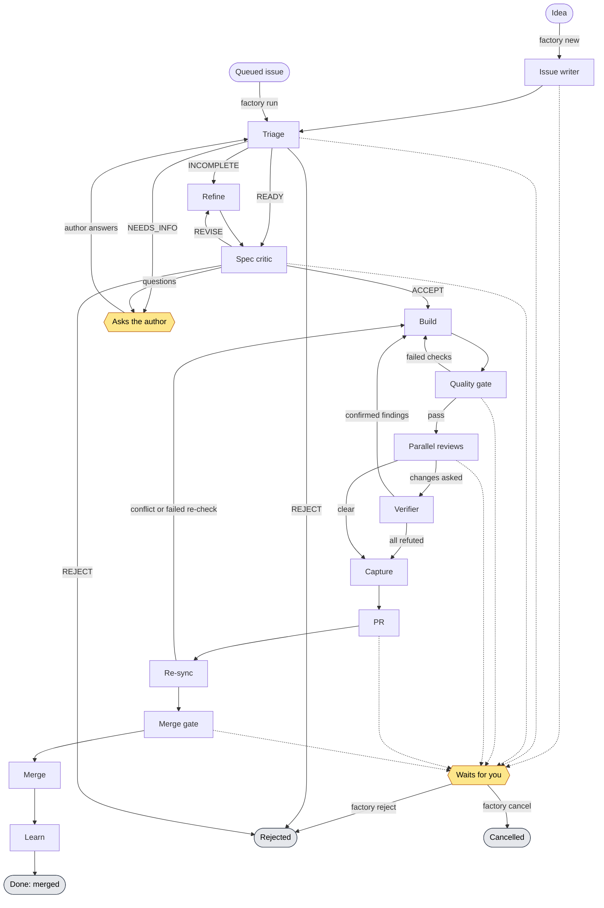

# Software Factory

[](https://github.com/tomek-i/software-factory/actions/workflows/ci.yml) [](https://github.com/tomek-i/software-factory/releases/latest) [](LICENSE)

Give it a GitHub issue, or just an idea. Get back a reviewed, tested pull request.

- **You give it:** a GitHub issue, or a free-text idea that `factory new` turns into one.
- **You get back:** a pull request that passed your checks and several AI reviews.
  For a UI change it comes with before/after screenshots and a narrated walkthrough video.
- **It runs on:** headless Claude Code with your own Claude subscription, not API billing.
- **You stay in charge:** by default it waits for you before it merges.

It runs in two modes on one engine:

- **CLI mode**: install into a single repo and drive it from the terminal.
- **Web mode**: `factory serve` opens a local web app over every registered repo.
  Queue issues, watch runs going on in parallel, and decide at gates (see [Web mode](#web-mode)).

> **Status: early development.** What works today:
>
> - `factory new` drafts issues from an idea.
> - `factory run` takes a queued issue all the way to a merged PR (see [Pipeline](#pipeline)).
> - After the merge, a learner proposes lessons for you to approve (`factory lessons`).
> - By default the run waits for you at the `merge` gate.
> - `factory work` and `factory serve` work through every registered repo's queue.
> - `factory serve` adds a local web app to draft and queue issues, watch runs and decide at gates.

## Docs

The details live in `docs/`, one fact per line:

- [Pipeline](docs/pipeline.md): what each stage does, from triage to learn.
- [Runs](docs/runs.md): starting, naming, the worker, merging on GitHub, cleanup and escalations.
- [Agent permissions](docs/agent-permissions.md): what each role may read and write.
- [Run artifacts](docs/run-artifacts.md): the files each run leaves behind.
- [Trust](docs/trust.md): trusted authors and status labels.
- [Lessons](docs/lessons.md): how the factory learns from its runs.
- [Writing issues from an idea](docs/factory-new.md): `factory new`.
- [Media hosting](docs/media.md): where screenshots and videos go.
- [Web mode](docs/web-mode.md): `factory serve`.
- [Moving between machines](docs/moving-between-machines.md): `factory export` and `factory import`.
- [Repository settings](docs/repo-settings.md): how this repo protects its own `main`.

## Pipeline



Triage reads the issue, refine fills in what it leaves open, and a spec critic checks the spec against the code.
A builder then works in its own worktree, and the quality gate runs your checks on its commit.
Reviewers look at the change through several lenses at once, and a verifier checks the findings they raise.
One lens checks the issue's acceptance criteria one by one; the met ones are ticked on the issue once the PR is merged.
Capture shows a UI change in the PR, re-sync merges the default branch in, and the merge gate decides.
After the merge, a learner proposes lessons.
Each stage is described in [docs/pipeline.md](docs/pipeline.md).

Yellow hexagons are where the run stops for a person.
Dotted lines show where it can wait for you: a gate in `human` mode, a hard-rule hit, a loop cap or a stall.

- **Stages**: issue writer (only for `factory new`), triage, refine (only for an INCOMPLETE issue), spec critic, build, quality gate, parallel reviews, verifier, capture, PR, re-sync, merge gate, merge, learn.
- **Gates**: `issue_writer`, `triage`, `critic`, `review`, `pr` and `merge`. Each has a mode:
  - `always`: pass through.
  - `auto`: the agent decides, or escalates with reasons.
  - `human`: always stop for you.
- **Gate defaults**: `issue_writer: human`, `triage: auto`, `critic: auto`, `review: auto`, `pr: always`, `merge: human`.
  - The config also accepts a `plan` gate (default `always`), but no stage uses it yet.
- **Loops** always go back to an earlier stage, up to a cap, then escalate to you:
  - critic REVISE → refine, up to `loops.max_critic_rounds` (default 2);
  - failed checks → build, up to `loops.max_build_iterations` (default 5);
  - confirmed review findings → build, up to `loops.max_review_rounds` (default 3);
  - re-sync conflict or failed re-check → build, which costs a review round.
- **Stalls**: a loop that fails the same way twice in a row escalates early, so a stuck builder does not use up the cap.
- **Hard rules** (protected paths, new dependencies, secret/env changes) always escalate to you, whatever the gate mode.
  - Only a per-run `--unsafe` flag lifts them.
  - It can never be set in config.
  - The full list is in [Pipeline: Hard rules](docs/pipeline.md#hard-rules).
- **Questions**: triage and the spec critic can ask the issue's author.
  - The run waits in `needs_info` until the author answers.
- **State changes need evidence**: for example, reviews only start when the commit that passed the quality gate is the branch's current HEAD.

## Requirements

- Node.js 22.12+ (and pnpm, to work on the factory from source)
- Git
- GitHub CLI (`gh`) 2.50 or newer, logged in
- Claude Code (`claude`), logged in with your subscription.
  - The factory removes `ANTHROPIC_API_KEY` from the agents' environment, so runs use your subscription, not API billing.
  - It also keeps your GitHub login away from agents (see [Agent permissions](docs/agent-permissions.md)).
- Optional, for screenshots and videos of UI changes: Playwright's Chromium.
  - Installing the factory installs the `playwright` package (an optional dependency) but never downloads browsers.
  - Download Chromium once with the factory's own Playwright, so the browser build matches it.
  - A bare `npx playwright` elsewhere fetches the latest Playwright, whose browser the factory cannot use.
    - npm install (PowerShell or bash): `cd "$(npm root -g)/@tomek-i/software-factory"`, then `npx playwright install chromium`.
    - Source checkout: `pnpm exec playwright install chromium`.
  - Without it the capture stage is skipped with a note and runs carry on.
  - If the factory's own `playwright` package is missing, the copy the [narrate](https://github.com/tomek-i/narrate-plugin) Claude Code plugin ships with is used, as far as `app.narrate` allows:
    - with `auto` (the default), the newest plugin in the cache;
    - with a path to `narrate.mjs`, only the plugin that path belongs to;
    - with `off`, not at all.
- Optional, so everyone can see the screenshots and videos in the factory's PRs: run `factory login github` once.
  See [Media hosting](docs/media.md).
- Optional, for a narrated walkthrough: the narrate Claude Code plugin and `ffmpeg` on PATH.
  See [Narrated walkthrough](docs/pipeline.md#narrated-walkthrough) under the capture stage.

## Usage

```sh
npm i -g @tomek-i/software-factory   # puts `factory` on your PATH

# in the repo you want to use the factory on
factory init
```

- **Update** with `npm i -g @tomek-i/software-factory@latest`; **remove** with `npm rm -g @tomek-i/software-factory`.
- **With pnpm:** `pnpm add -g @tomek-i/software-factory`.
  - It needs pnpm's global bin folder on your `PATH` (run `pnpm setup` once if it complains).
  - If pnpm reports that it skipped `better-sqlite3`'s build script, run `pnpm approve-builds -g` and approve it.
- **From source** (to work on the factory itself): in a checkout, `pnpm install`, `pnpm build`, then `pnpm add -g "$(pwd)/apps/cli"`.
  - This links the checkout instead of copying it, so a later `pnpm build` updates the global `factory`.
  - But it cannot run the factory on this repo's own issues (see [Dogfooding](#dogfooding)).
  - `pnpm -C <path-to-this-repo> factory` is not a substitute: pnpm runs the script in the factory's own folder.
    The CLI acts on its working directory, so it would always act on this repo.

`factory init`:

- detects your stack (Node, .NET, Python, Go) and writes `.factory/config.yaml` with check commands. Review and commit it.
- writes `.factory/lessons.md`, which agents read before every run.
- adds runtime state (`.factory/runs/`, `.factory/factory.db*`, `.worktrees/`, `.factory/drafts/`) to `.gitignore`.
- registers the project in `.factory/factory.db`.
- adds the repo to your project list (see below).
- creates GitHub status labels only if you enabled `github.status_labels` (off by default; see [Status labels](docs/trust.md#status-labels)).

It is safe to re-run.
An existing config is never overwritten; `factory config reset` brings settings back to the defaults (see [Configuration](#configuration)).

The project list holds every repo you ran `factory init` in, so `factory work` and `factory serve` can find them.

- It is one file per user:
  - on Windows, `%LOCALAPPDATA%\software-factory\projects.json`;
  - elsewhere, `~/.config/software-factory/projects.json` (`$XDG_CONFIG_HOME`).
- `FACTORY_DATA_DIR` moves that folder, together with the GitHub browser profile.
- The list only holds paths and names; each repo keeps its own state.
- `factory projects` lists the repos and flags one whose folder has gone, or that has no `.factory/factory.db`.
- `factory projects remove <path>` drops a repo from the list. The repo and its database are not touched.
- A repo set up before the list existed joins it when you run `factory init` there again.

`factory login github` opens a browser and waits for you to sign in to GitHub there.
The factory then attaches screenshots and videos to its PRs.
Run it again to check who is signed in.

### Writing issues from an idea

```sh
factory new "export orders as CSV"           # draft an issue from an idea
factory new "export orders as CSV" --queue   # the same, and queue the issues once created
factory new --list                           # drafts waiting for you
factory new --approve <draft>                # create a draft on GitHub and sync it
factory new --approve <draft> --queue        # the same, and queue the issues
factory new --discard <draft>                # drop a draft
```

- An issue writer agent drafts the issue; by default the `issue_writer` gate waits for you to approve the draft.
- Without `--queue`, `factory work` and `factory serve` leave the new issues alone until you queue them.
- How drafts, the gate and sub-issues work: [Writing issues from an idea](docs/factory-new.md).
- The web app's New issue screen does the same, with the same rules: [Web mode](docs/web-mode.md#screens).

### Choosing what the factory works on

Work is picked **locally**, never from GitHub labels, so nobody on GitHub can feed issues into your factory.

```sh
factory sync               # pull open issues from GitHub into .factory/factory.db; finishes runs whose PR was merged or closed
factory issues             # list them (Q marks queued issues); -q/--queued, -a/--all
factory queue 12 15 18     # queue issues for the factory (fetches unsynced ones)
factory unqueue 15         # take one back out
```

Issues closed on GitHub drop out of the queue on the next sync.

### Working through the queue

```sh
factory work               # work through the queues of every registered project until stopped; --max-runs <n> (default 3)
factory stop               # ask running workers (`factory work`, `factory serve`) to start no more runs, finish the ones going on, and exit
factory stop --now         # ask them to interrupt their runs instead and exit; the runs can be continued
```

- The worker continues stopped runs first, then starts queued issues in queue order.
- It keeps to `concurrency.max_runs`, `--max-runs` and `github.max_starts_per_day`, and pauses on the usage limit.
- How it picks, its limits and stopping: [Working through the queue](docs/runs.md#working-through-the-queue).

### Moving between machines

```sh
factory export ~/factory-myrepo.json         # on the first machine; no file prints to stdout
factory import ~/factory-myrepo.json --dry-run   # on the other machine: what would be added or changed
factory import ~/factory-myrepo.json
factory sync
```

- It moves the local state `factory sync` cannot rebuild to another clone of the same GitHub repo.
- **Finish or cancel a run on the machine that started it**, then export.
- **The snapshot is as trusted as your own database**: keep it out of the repo and only import your own.
- What travels and how import merges: [Moving between machines](docs/moving-between-machines.md).

### Web mode

```sh
factory serve              # the web app on http://127.0.0.1:4180, plus the worker of `factory work`
factory serve --port 4181 --max-runs 2 --no-open
```

- It does what `factory work` does and serves a web app for every project in the project list.
- It prints a link with a session token and opens it in your browser (`--no-open` only prints it).
- Its screens are Inbox, Runs, Run details, Backlog and New issue; click a run to open its details.
- The screens, the actions and how it stays private: [Web mode](docs/web-mode.md).

### Running an issue

```sh
factory run 12             # run issue #12 until it needs you (syncs and queues it first if needed); --unsafe lifts hard rules for this run only
factory run 12 15          # run several issues at once, up to concurrency.max_runs; each line is prefixed [#12], [#15]
factory status             # active runs: state, round, cost, waiting gate; -a/--all includes finished ones (finishes merged runs first); notes lessons waiting for you
factory logs 12            # events and agent log excerpts; -f/--follow follows a running run
factory show 12            # overview: state, gate, branch, PR, verdict summaries, files in the run folder
factory show 12 triage     # one file in full: triage, refine and critic (latest spec round), build, checks or capture (latest round), approval, learn, or a path like round-2/checks.md
factory approve <run>      # let a run waiting at a gate continue and keep running it; -m "why", --no-run to only record it
factory reject <run> -m "why"   # end a run waiting at a gate
factory resume <run> --to build -m "why"   # send an escalated run back to a stage and keep running it; --reset-loops, --no-run
factory cancel <run>       # stop the run, its agent and running checks; -m "why" is optional (see Cleaning up finished runs)
factory cleanup            # remove the worktrees and branches finished runs left behind; --dry-run lists them first
factory lessons            # lessons the learner proposed, waiting for you; -a/--all includes approved and rejected ones
factory lessons approve 3 4        # open one PR that appends these lessons to .factory/lessons.md
factory lessons reject 5 -m "why"  # never apply this lesson; -m is optional
```

- `<run>` is a run id, a unique prefix of one, or an issue number for that issue's latest run (see [Naming a run](docs/runs.md#naming-a-run)).
- Starting, several runs, merging on GitHub, cleanup and escalations: [Runs](docs/runs.md).
- What each stage does: [Pipeline](docs/pipeline.md).
- What each agent may do: [Agent permissions](docs/agent-permissions.md).
- The files a run leaves in `.factory/runs/<run>/`: [Run artifacts](docs/run-artifacts.md).
- Config, prompts, lessons and the `CLAUDE.md` agents get are read from the default branch: [What steers the agents](docs/runs.md#what-steers-the-agents).
- Approving and rejecting lessons: [Lessons](docs/lessons.md).
- Whose issues count as the spec: [Trust](docs/trust.md).

## Configuration

See the comments in the generated `.factory/config.yaml`. The main sections:

| Key | Purpose |
|---|---|
| `project` | `name` and `default_branch` (default `main`), the branch the factory builds from and reads its config from |
| `checks` | Commands that must all pass before reviews start |
| `app` | How to start the app for screenshots and videos: `start` (a shell command run in the worktree; unset means no capture), `url` (must contain `{port}`, which is filled in; default `http://localhost:{port}`), `port_env` (the variable that carries the port, default `PORT`), `ready_timeout_sec` (how long `url` may take to answer, default 180), `narrate` (`auto`, `off` or a path to narrate.mjs, see [Narrated walkthrough](docs/pipeline.md#narrated-walkthrough)) and `env` (names of variables to pass from your environment to the app, which otherwise gets only a minimal one; tokens are never passed) |
| `gates` | `always` / `auto` / `human` per gate (see [Pipeline](#pipeline) for the defaults) |
| `hard_rules` | Paths and triggers that always escalate to a human (see [Hard rules](docs/pipeline.md#hard-rules)) |
| `merge` | `method`: `merge` (default), `squash` or `rebase`, as the repo allows; `checks_timeout_min`: how long to wait for required status checks before asking you (default 30) |
| `loops` | Caps for build iterations, review rounds and spec critic rounds |
| `reviews` | Which review lenses run always and which only for UI changes; the `acceptance` lens always runs |
| `models` | Model and effort per agent role and review lens, with overrides when triage rates the risk HIGH. Left out, every agent uses the recommended model (`DEFAULT_MODELS` in `packages/shared/src/config.ts`, shown commented out in a new config). Whatever the file sets wins over every recommendation: `default` and `effort` reach every agent it does not name, and the recommendations only fill in the rest |
| `concurrency` | `max_runs`: how many runs `factory run` drives at once, and how many the worker drives per project (default 2) |
| `trust` | Whose issues and comments count as the spec (see [Trust](docs/trust.md)) |
| `github` | Optional status labels (`status_labels`, `label_prefix`); `max_starts_per_day`: how many new runs the worker starts per project in 24 hours (default 10). `poll_interval_sec` is accepted but not used yet |

Anything the file leaves out uses the factory's default, so new settings and changed defaults reach your project with the next factory update.
A value written in the file stays as it is.
To go back to the defaults for some settings:

```bash
factory config reset models                 # a whole section
factory config reset models.roles.builder   # one entry
factory config reset --all                  # everything except project, checks, app and trust
```

- It removes those lines (and the comments right above them) from the working copy's `.factory/config.yaml`.
- It leaves the rest of the file as it was.
- Commit the change and merge it: runs read the config from the default branch on GitHub.
- A config written by an older `factory init` spells out the models of that time.
  `factory config reset models` gives it the current recommendations.

## Development

```sh
pnpm test        # vitest
pnpm typecheck   # tsc, including tests
pnpm lint        # eslint
pnpm build       # tsc -b, the web app with Vite, then the npm package's bundle (apps/cli/dist)
pnpm factory status # run the CLI from source, on this repo
```

The web app:

- To work on it with hot reload, run `factory serve --no-open` from the built CLI, then `pnpm -C apps/web dev`.
- Vite proxies `/api` to the server (`FACTORY_SERVE_URL`, default `http://127.0.0.1:4180`).
- Open the printed link with Vite's port instead of 4180.
- The web tests run in jsdom with a fake server and event stream.

Browser tests:

- The capture tests that drive a real browser run only where Playwright's Chromium is installed (`pnpm exec playwright install chromium`).
- They are skipped otherwise.
- Set `FACTORY_REQUIRE_BROWSER=1` (for example in CI) to make a missing browser fail the tests instead.

Narrate tests:

- The tests that render with the real narrate plugin are skipped unless you set `FACTORY_TEST_NARRATE=1`.
- That is because they test the narrate version installed on your machine, not this repo.
- With the flag they need the plugin (in `~/.claude/plugins/cache`), ffmpeg on `PATH` and Playwright's Chromium, and fail if any of them is missing.
- They use narrate's silent mock voice, so they cost nothing:

  ```sh
  FACTORY_TEST_NARRATE=1 pnpm vitest run packages/core/src/capture/narrate.test.ts
  ```

- The quality gate runs `pnpm test` with your environment, so leave the flag unset in the shell that runs the factory.
  Otherwise an old narrate install can fail a run's `test` check.

Layout:

```
apps/cli          the `factory` command, published to npm as @tomek-i/software-factory
apps/server       `factory serve`'s local HTTP server: API over the run actions, event stream, session token
apps/web          the web app (React, Vite, Tailwind), served by apps/server
packages/core     engine: config, SQLite store, state machine, gates, agent runner, prompts,
                  worktrees, quality gate, capture (app, browser), pipeline driver, init, GitHub issue sync, lessons PR,
                  and the run actions the CLI formats (run, approve, reject, resume, cancel, show, lessons, drafts)
  src/pipeline/   the pipeline driver (driver.ts) and one module per stage in stages/ (triage, refine, critic,
                  build, gate, review, capture, pr, merge, learn)
  prompts/        shipped role prompts (override per repo in .factory/prompts/<role>.md)
  test/           fake `claude` binary and fixtures: tests never spend real usage
packages/shared   zod schemas shared by everything (config, run states, agent verdicts)
docs/             the detailed docs linked from this README
```

[CLAUDE.md](CLAUDE.md) has a file-by-file map, the invariants, checklists for adding a stage, an agent role, a migration or a GitHub call, and the security checklist.
Read it before changing the engine, whether you are a person or a Claude Code session.

### Dogfooding

The factory works on its own issues.
It runs from the **published npm package**, never from the code its runs change.

- **Why:** a merged PR, or an agent reaching outside its worktree, would otherwise change the code that is running.
  - `factory run`, `approve`, `resume` and `new "<idea>"` refuse to start agents with a copy that lives inside the repository they would change.
  - Inside means its checkout or one of its `.worktrees/`.
  - A global `factory` linked from the checkout with `pnpm add -g "$(pwd)/apps/cli"` counts as inside.
  - Other commands, such as `pnpm factory status` or `approve --no-run`, still work from source.
- **Install** with `npm i -g @tomek-i/software-factory`. It replaces a global `factory` linked from a checkout.
- **Register this repo** with `factory init` in your checkout. The committed `.factory/config.yaml` is kept.
- **Run an issue** with `factory run <issue>` in your checkout.
  - In `.factory/config.yaml` every gate but `merge` is on `auto`: agents decide.
  - A run stops for you only on an escalation (a hard rule, an untrusted author, a loop cap) and at the merge gate.
  - The first run had every gate on `human`.
  - Note that on `human` the spec critic runs no agent; the gate only asks you to accept the spec triage already showed you.
- **Update** with `npm i -g @tomek-i/software-factory@latest` after a release, when no run is in progress.
- **Unreleased `main`:** to run code that is merged but not released yet, build a clone outside every repository and link it instead (PowerShell):

  ```powershell
  $pinned = "$env:LOCALAPPDATA\software-factory\pinned"
  git clone https://github.com/tomek-i/software-factory $pinned
  pnpm -C $pinned install --frozen-lockfile; pnpm -C $pinned build
  pnpm add -g "$pinned\apps\cli"
  ```

  Update it only after a PR merged and no run is in progress:
  `git -C $pinned pull --ff-only; pnpm -C $pinned install --frozen-lockfile; pnpm -C $pinned build`.

### Releases

[release-please](https://github.com/googleapis/release-please) keeps a release PR open with the changelog built from the conventional commits on `main`.

- Merging that PR tags `v<version>` and publishes a GitHub release.
- It bumps the version in `package.json`, `apps/cli/package.json` and `factory --version`.
- It stages the CLI on npm as [`@tomek-i/software-factory`](https://www.npmjs.com/package/@tomek-i/software-factory).
- Only `feat`, `fix`, `perf`, `refactor`, `docs` and `revert` commits show in the changelog.
- CI does not run on the release PR: it is opened with the default `GITHUB_TOKEN`, and GitHub does not start workflows for that token's events.
- The release PR only changes `CHANGELOG.md`, `.release-please-manifest.json` and version strings.

The npm package:

- The npm package is `apps/cli`.
- `apps/cli/scripts/bundle.mjs` bundles the CLI and the workspace packages into `dist/main.js` with esbuild.
- It copies the shipped prompts and the built web app next to it.
- npm dependencies stay external, so every one the bundle imports must be listed in `apps/cli/package.json`.
- CI packs it on every push and checks the tarball (`apps/cli/scripts/check-pack.mjs`).
- The release workflow publishes with npm [trusted publishing](https://docs.npmjs.com/trusted-publishers), so no npm token is stored.
- npm only allows a trusted publisher on a package that exists, so the package was set up once by hand:

1. Merge the first release PR that includes the npm package. Its `npm` job fails, because the package does not exist yet.
2. Publish that release by hand from its tag, so the npm version matches the git tag:
   `git checkout v<version>`, `npm login`, `pnpm install --frozen-lockfile`, `pnpm build`, `pnpm --filter @tomek-i/software-factory publish`.
3. On npmjs.com, add a trusted publisher in the package's settings: GitHub Actions, repository `tomek-i/software-factory`, workflow `release-please.yml`, no environment.
   Leave "Allow npm publish" and "Allow npm dist-tag" unticked.
   Set publishing access to require two-factor authentication without bypass tokens.

After that, each release **stages** its version on npm (`npm stage publish`) rather than publishing it.

- Nothing goes live without a maintainer's 2FA, even if the workflow or an action it uses is compromised.
- To make a release live, approve it on npmjs.com.
- Or run `npm stage list @tomek-i/software-factory` and then `npm stage approve <stage-id>`.

## Contributing

Issues and pull requests are welcome. See [CONTRIBUTING.md](CONTRIBUTING.md).
Report security problems privately, as described in [SECURITY.md](SECURITY.md).

## License

Software Factory is **source-available** under the [PolyForm Noncommercial License 1.0.0](LICENSE).
It is not open source in the OSI sense.

**Free to use for:**
- personal, hobby and private projects, as long as there is no anticipated commercial application;
- study, research and experiments, on the same condition;
- charities, schools, public research and government bodies.

**Needs a commercial license:**
- any use at or for a for-profit company, including internal tools;
- using it to build anything you plan to sell, such as an app or a SaaS;
- offering it, or a service built on it, to paying customers.

**Commercial license:** open an issue titled "Commercial license", or contact [tomek-i](https://github.com/tomek-i) through their GitHub profile.

**Contributing:** pull requests from others need a signed [Contributor License Agreement](CLA.md), so contributions can be included in commercially licensed versions.
A bot asks for it on your first pull request.
