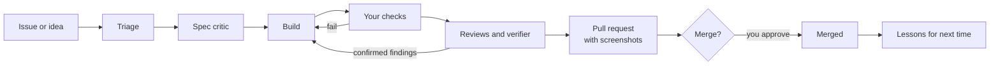

# Software Factory

[](https://github.com/tomek-i/software-factory/actions/workflows/ci.yml) [](https://github.com/tomek-i/software-factory/releases/latest) [](LICENSE)

Give it a GitHub issue, or just an idea. Get back a reviewed, tested pull request.

Software Factory runs Claude Code agents on your own machine, with your own Claude subscription.
One agent checks the issue, one builds, several review, and you decide at the points you choose.
By default nothing merges until you say so.

## What a run looks like



1. **Triage** reads the issue and the code, and asks the author when something is unclear.
2. **A critic** checks the issue's claims against the real code before anything is built.
3. **The builder** works in its own git worktree until the checks you configured (tests, lint, types) pass.
   If it can't get there in a few rounds, the run stops for you.
4. **Reviewers** look at the change for code, security, docs and, for UI changes, UX and visual design.
   A verifier checks each finding before the builder has to act on it.
   Optionally, the [claude-security plugin](docs/pipeline.md#deep-security-scan) runs a deep security scan of the change too.
   `factory audit` runs it on the whole default branch ([Security audits](docs/security-audit.md)).
5. **The pull request** explains the change and, for a UI change, shows before and after screenshots and a walkthrough video, narrated when the narrate plugin is installed.
6. **You merge**, or [let an agent decide](docs/configuration.md#gates). Afterwards a learner proposes lessons, which you approve.

Every stage, gate and loop: [Pipeline](docs/pipeline.md).

## Why it's different

- **Your rules, from your default branch.** Checks, gates and prompts are read from your default branch on GitHub, so a branch can't change the rules it is judged by.
- **Human gates where you want them.** Each gate is `always` (pass through), `auto` (an agent decides) or `human` (stop for you).
  Risky changes, such as new dependencies or edits to CI workflows, stop for you whatever the gate says ([hard rules](docs/pipeline.md#hard-rules)), and so do issues from untrusted authors.
- **Untrusted text stays data.** Issues from strangers are handled as untrusted input, and agents run with `gh` logged out and git credentials off ([Agent permissions](docs/agent-permissions.md)).
- **It shows its work.** Every run keeps its specs, reports, reviews and decisions in `.factory/runs/`.
- **Runs on your subscription.** It drives headless Claude Code and removes `ANTHROPIC_API_KEY` from the agents, so there is no API billing.
- **Terminal or browser.** Use the `factory` command, or `factory serve` for a local web app over all your repos.

## Quick start

```sh
npm i -g @tomek-i/software-factory

cd your-repo
factory init --sync    # writes .factory/config.yaml and pulls in the open issues
git add .factory/config.yaml && git commit -m "chore: add factory config" && git push
factory issues         # see what's there
factory run 42         # take issue #42 all the way to a pull request
```

Runs read the config from your default branch on GitHub, so push it before the first run.

Rather click than type? `factory serve` opens the web app, where you queue issues, watch runs and approve them.

Everything else: [Using the factory](docs/usage.md).

## Requirements

- Node.js 22.12+
- Git
- GitHub CLI (`gh`) 2.50 or newer, logged in
- Claude Code (`claude`), logged in with your subscription
- Optional, for screenshots and videos of UI changes: Playwright's Chromium, installed with the factory's own Playwright so the versions match:
  - npm install (PowerShell or bash): `cd "$(npm root -g)/@tomek-i/software-factory"`, then `npx playwright install chromium`.
  - Source checkout: `pnpm exec playwright install chromium`.

  Without it, runs carry on without screenshots.
  More, including narrated videos: [Capture](docs/capture.md#playwright-and-chromium).

## Docs

- [Using the factory](docs/usage.md): every command, from install to cleanup.
- [Configuration](docs/configuration.md): what `.factory/config.yaml` sets.
- [Pipeline](docs/pipeline.md): what each stage does.

All docs: [docs/](docs/README.md).

## Status

Early development. The factory already works on its own issues (see [Dogfooding](CONTRIBUTING.md#dogfooding)).
Expect changes between releases; the [changelog](CHANGELOG.md) lists them.

## Contributing

Bug reports and ideas are welcome as [issues](https://github.com/tomek-i/software-factory/issues).
To work on the code, start with [CONTRIBUTING.md](CONTRIBUTING.md).
Security problems go to private reporting: see [SECURITY.md](SECURITY.md).

## License

Software Factory is **source-available** under the [PolyForm Noncommercial License 1.0.0](LICENSE).
It is not open source in the OSI sense.

**Free to use for:**
- personal, hobby and private projects, as long as there is no anticipated commercial application;
- study, research and experiments, on the same condition;
- charities, schools, public research and government bodies.

**Needs a commercial license:**
- any use at or for a for-profit company, including internal tools;
- using it to build anything you plan to sell, such as an app or a SaaS;
- offering it, or a service built on it, to paying customers.

**Commercial license:** open an issue titled "Commercial license", or contact [tomek-i](https://github.com/tomek-i) through their GitHub profile.

**Contributing:** pull requests from others need a signed [Contributor License Agreement](CLA.md), so contributions can be included in commercially licensed versions.
A bot asks for it on your first pull request.
