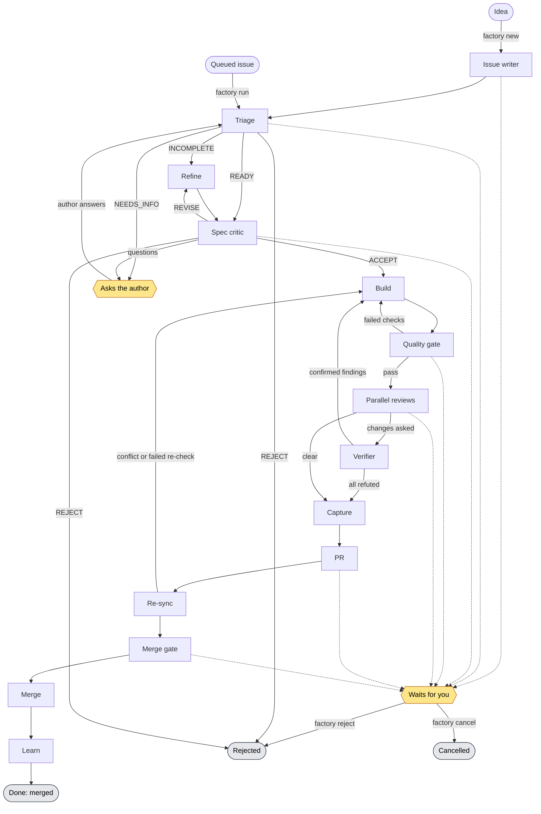

# Software Factory

[](https://github.com/tomek-i/software-factory/actions/workflows/ci.yml) [](https://github.com/tomek-i/software-factory/releases/latest) [](LICENSE)

Give it a GitHub issue, or just an idea. Get back a reviewed, tested pull request.

- **You give it:** a GitHub issue, or a free-text idea that `factory new` turns into one.
- **You get back:** a pull request that passed your checks and several AI reviews. For a UI change it comes with before/after screenshots and a narrated walkthrough video.
- **It runs on:** headless Claude Code with your own Claude subscription, not API billing.
- **You stay in charge:** by default it waits for you before it merges.

It runs in two modes on one engine:

- **CLI mode**: install into a single repo and drive it from the terminal.
- **Web mode** *(planned)*: a local dashboard that manages several repos, syncs GitHub issues both ways and runs issues in parallel.

> **Status: early development.** What works today:
>
> - `factory new` drafts issues from an idea.
> - `factory run` takes a queued issue all the way to a merged PR (see [Pipeline](#pipeline)).
> - After the merge, a learner proposes lessons for you to approve (`factory lessons`).
> - By default the run waits for you at the `merge` gate.

## Pipeline



Yellow hexagons are where the run stops for a person. Dotted lines show where it can wait for you: a gate in `human` mode, a hard-rule hit, a loop cap or a stall.

- **Stages**: issue writer (only for `factory new`), triage, refine (only for an INCOMPLETE issue), spec critic, build, quality gate, parallel reviews, verifier, capture, PR, re-sync, merge gate, merge, learn.
- **Gates**: `issue_writer`, `triage`, `critic`, `review`, `pr` and `merge`. Each has a mode:
  - `always`: pass through.
  - `auto`: the agent decides, or escalates with reasons.
  - `human`: always stop for you.
- **Gate defaults**: `issue_writer: human`, `triage: auto`, `critic: auto`, `review: auto`, `pr: always`, `merge: human`. The config also accepts a `plan` gate (default `always`), but no stage uses it yet.
- **Loops** always go back to an earlier stage, up to a cap, then escalate to you:
  - critic REVISE → refine, up to `loops.max_critic_rounds` (default 2);
  - failed checks → build, up to `loops.max_build_iterations` (default 5);
  - confirmed review findings → build, up to `loops.max_review_rounds` (default 3);
  - re-sync conflict or failed re-check → build, which costs a review round.
- **Stalls**: a loop that fails the same way twice in a row escalates early, so a stuck builder does not use up the cap.
- **Hard rules** (protected paths, new dependencies, secret/env changes) always escalate to you, whatever the gate mode.
  - Only a per-run `--unsafe` flag lifts them.
  - It can never be set in config.
- **Questions**: triage and the spec critic can ask the issue's author. The run waits in `needs_info` until the author answers.
- **State changes need evidence**: for example, reviews only start when the commit that passed the quality gate is the branch's current HEAD.

## Requirements

- Node.js 22.12+ and pnpm
- Git
- GitHub CLI (`gh`) 2.50 or newer, logged in
- Claude Code (`claude`), logged in with your subscription.
  - The factory removes `ANTHROPIC_API_KEY` from the agents' environment, so runs use your subscription, not API billing.
- Optional, for screenshots and videos of UI changes: Playwright's Chromium.
  - `pnpm install` installs the `playwright` package (an optional dependency) but never downloads browsers.
  - Run `pnpm exec playwright install chromium` once in the factory's checkout.
  - Without it the capture stage is skipped with a note and runs carry on.
  - If the factory's own `playwright` package is missing but the [narrate](https://github.com/tomek-i/narrate-plugin) Claude Code plugin is installed, the plugin's copy is used.
- Optional, so everyone can see the screenshots and videos in the factory's PRs: run `factory login github` once. See [Where the media goes](#where-the-media-goes).
- Optional, for a narrated walkthrough: the narrate Claude Code plugin and `ffmpeg` on PATH. See [Narrated walkthrough](#narrated-walkthrough) under the capture stage.

## Usage

```sh
pnpm install
pnpm build

# in the repo you want to use the factory on
node <path-to-this-repo>/apps/cli/dist/main.js init
```

`factory init`:

- detects your stack (Node, .NET, Python, Go) and writes `.factory/config.yaml` with check commands. Review and commit it.
- writes `.factory/lessons.md`, which agents read before every run.
- adds runtime state (`.factory/runs/`, `.factory/factory.db*`, `.worktrees/`, `.factory/drafts/`) to `.gitignore`.
- registers the project in `.factory/factory.db`.
- creates GitHub status labels only if you enabled `github.status_labels` (off by default; see below).

It is safe to re-run. An existing config is never overwritten.

`factory login github` opens a browser and waits for you to sign in to GitHub there. The factory then attaches screenshots and videos to its PRs. Run it again to check who is signed in.

### Writing issues from an idea

```sh
factory new "export orders as CSV"   # draft an issue from an idea
factory new --list                   # drafts waiting for you
factory new --approve <draft>        # create a draft on GitHub, sync it and queue it
factory new --discard <draft>        # drop a draft
```

`factory new` runs an issue writer agent on your idea.

- **Access**: it has no shell. It reads the repo and writes only its draft, `.factory/drafts/<draft>/draft.md`. `factory new` adds `.factory/drafts/` to `.gitignore` if it is missing.
- **The draft** is an issue with a title, `## Why`, `## What`, `## Acceptance criteria` (checkboxes), `## Scope` and `## Out of scope`, a UI flag and a risk rating.
- **Big ideas**: an idea too big for one PR becomes a parent issue plus two or more sub-issues (at most 10), each with the same structure.
- **Dependencies**: a sub-issue that needs another first says so with `DEPENDS_ON`. That ends up as `Depends on: #n` in its body.
- **Checks**: the draft is checked strictly. A malformed one gets one retry, then it is kept for you to fix or discard.

The `issue_writer` gate then decides:

- `human` (default): the draft is printed and saved, and the command exits. Edit `draft.md` if you like, then `factory new --approve <draft>` creates it. The file is read and checked again first.
- `auto`: the agent's own `DECISION: PROCEED` creates it straight away. `ESCALATE` waits for you as above, with its reasons.
- `always`: created straight away.

With `auto` or `always`, nobody reads the draft before it becomes an issue:

- It becomes a trusted issue (see [Trusted authors](#trusted-authors)), so later stages treat it as the spec.
- The issue writer cannot read run folders (`.factory/runs/`), worktrees or other drafts, so text from untrusted issues does not reach it that way. But it does read the repo.
- Keep the default `human` unless you trust what is in your repo.

Creating a draft:

- always prints the full draft first;
- opens the issues on GitHub (no labels);
- links each sub-issue to the parent as a real GitHub sub-issue;
- syncs them into `.factory/factory.db`;
- queues the buildable ones: the single issue, or the sub-issues (never their parent);
- prints the numbers and the `factory run` command to start them.

If something goes wrong:

- What has been created is recorded in `.factory/factory.db`. If GitHub fails halfway, `factory new --approve` again only does what is left.
- An issue whose draft entry you edited after it was created is refused, rather than matched up by position.
- If `gh issue create` succeeds but its output can't be read, the error names the title. Check GitHub before approving again, as that issue may exist already.
- A draft with files that git tracks is refused. `factory new` only writes ignored files, so such a draft came from a commit, possibly someone else's branch.

`<draft>` is a draft id or a unique prefix of one.

### Choosing what the factory works on

Work is picked **locally**, never from GitHub labels, so nobody on GitHub can feed issues into your factory.

```sh
factory sync               # pull open issues from GitHub into .factory/factory.db; finishes runs whose PR was merged or closed
factory issues             # list them (Q marks queued issues); -q/--queued, -a/--all
factory queue 12 15 18     # queue issues for the factory (fetches unsynced ones)
factory unqueue 15         # take one back out
```

Issues closed on GitHub drop out of the queue on the next sync.

### Running an issue

```sh
factory run 12             # run issue #12 until it needs you (syncs and queues it first if needed); --unsafe lifts hard rules for this run only
factory run 12 15          # run several issues at once, up to concurrency.max_runs; each line is prefixed [#12], [#15]
factory status             # active runs: state, round, cost, waiting gate; -a/--all includes finished ones (finishes merged runs first); notes lessons waiting for you
factory logs 12            # events and agent log excerpts; -f/--follow follows a running run
factory show 12            # overview: state, gate, branch, PR, verdict summaries, files in the run folder
factory show 12 triage     # one file in full: triage, refine and critic (latest spec round), build, checks or capture (latest round), approval, learn, or a path like round-2/checks.md
factory approve <run>      # let a run waiting at a gate continue and keep running it; -m "why", --no-run to only record it
factory reject <run> -m "why"   # end a run waiting at a gate
factory resume <run> --to build -m "why"   # send an escalated run back to a stage and keep running it; --reset-loops, --no-run
factory cancel <run>       # stop the run, its agent and running checks; -m "why" is optional (see Cleaning up finished runs)
factory cleanup            # remove the worktrees and branches finished runs left behind; --dry-run lists them first
factory lessons            # lessons the learner proposed, waiting for you; -a/--all includes approved and rejected ones
factory lessons approve 3 4        # open one PR that appends these lessons to .factory/lessons.md
factory lessons reject 5 -m "why"  # never apply this lesson; -m is optional
```

**Starting a run.** `factory run <n>` is enough for a brand-new issue:

- Running it is your decision to work on it. If the issue isn't queued yet, it is fetched fresh from GitHub and queued, the same as `factory queue <n>`.
- Closed issues are refused.
- An issue by an author outside `trust.authors` still waits for you at triage.

**Several runs at once.** Give several numbers to run them side by side in one terminal:

- At most `concurrency.max_runs` (default 2) run at once. The rest wait their turn.
- An issue that can't start (closed, not on GitHub) is skipped. The others still run, and the command exits non-zero.
- Once your usage limit is hit, issues not started yet are left for later.
- Ctrl+C stops all of them.

**Approve, resume and reject**:

- They apply the config on the default branch, like `factory run`, so a local edit cannot change where an approved run goes.
- `factory approve` and `factory resume` carry on driving the run in the same terminal, as `factory run` would. With `--no-run` they only record the decision.

**Naming a run.** `<run>` is one of:

- a run id: the issue number, a slug of its title and a short random part, e.g. `49-shorter-builder-summaries-one-dfc238`. Runs created before this used `run-49-dfc23835`;
- a unique prefix of one;
- an issue number (`12`), for that issue's latest run. `#12` works too, but PowerShell reads `#` as the start of a comment, so quote it there (`'#12'`).

What `factory run` does today:

1. **Triage**: an agent with no shell reads the issue and the code.
   - It writes `triage.md`: `APPROVE`, `REJECT` or `NEEDS_INFO`, and `READINESS: READY | INCOMPLETE`.
   - Rejections and questions are posted on the issue.
   - The `triage` gate then decides whether to continue.
   - An approved issue that is INCOMPLETE goes to refine. A READY one skips refine and goes to the spec critic.
   - After the author answers, `factory run` triages the issue again. Run `factory sync` first so it sees an edited issue.
2. **Refine**: for an INCOMPLETE issue, a refine agent writes what the issue leaves open.
   - It has no shell, a read-only repo, and writes only its own file.
   - It writes acceptance criteria, scope, out of scope and open questions (with the assumption it made for each) in `spec-N/refine.md`, with `STATUS: REFINED`.
   - `BLOCKED` with a reason stops the run for you.
   - The engine posts the spec on the issue as one comment marked `<!-- factory:refine -->`. It edits that comment in place on later rounds, so the issue shows the current spec rather than every version.
3. **Spec critic**: a critic agent checks the issue's claims and acceptance criteria against the actual code, and the refined spec when there is one.
   - It has no shell, is read-only, and writes only its own file.
   - It writes `spec-N/critic.md` with `VERDICT: ACCEPT | REVISE | REJECT`, a `## Summary`, and `## Problems`, `## Questions` and `## Notes`.
   - **ACCEPT** passes the `critic` gate on to build.
     - The builder gets the refined spec and the critic's notes.
     - The reviewers, the verifier, the approver and the hard-rule deletion check judge the change against them too.
   - **Untrusted author**: the run always waits for you at the `critic` gate before build, whatever the gate mode. The spec reaches the builder marked as untrusted data.
   - **REVISE** goes back to refine with the critic's problems, up to `loops.max_critic_rounds` (default 2) critic rounds.
     - At the cap the run waits for you at the `critic` gate, with the open problems and the spec's open questions in the reason.
     - Approve the spec as it is, or send it back with `factory resume <run> --to refine -m "…"`. Refine gets your comment.
   - **REJECT** ends the run and posts the critic's problems on the issue.
   - **Questions** only the issue's author can answer are posted on the issue, and the run waits in `needs_info`, as when triage asks.
     - The author's answers change the issue itself. Once they have answered, `factory run` triages it again.
     - The spec then starts a new round, with a fresh `loops.max_critic_rounds` budget.
   - **Gate modes**: like the approver, the critic only runs in `auto` mode (the default).
     - `gates.critic: always` goes straight to build without a critic turn. A READY issue then goes from triage to build.
     - `human` waits for you without spending one.
   - Each spec round has its own `spec-N/` folder. The number only grows, so a later round or a re-triage never overwrites an earlier round's files.
4. **Build**: a builder agent works in its own worktree and commits.
   - The worktree is `.worktrees/<run>`, on branch `factory/<issue>-<slug>`, created from the latest `origin/<default branch>`.
   - It cannot push.
   - The engine scans every new commit for secrets (gitleaks if installed, otherwise built-in patterns). If it finds one, it sends the builder back, so a leaked key never reaches GitHub.
   - Then the engine pushes the branch (never forced) and opens a **draft** PR that closes the issue.
   - The PR title is the one the builder hands over: a Conventional Commit subject such as `feat(cli): add x`, so a squash merge leaves a conventional commit on the default branch.
   - The PR description starts with a short brief for you (What, How it was tested), with the builder's implementation notes collapsed underneath.
5. **Quality gate**: the engine runs your `checks` on the pushed commit, plus the secret scan again.
   - Checks run without `ANTHROPIC_API_KEY`, `GH_TOKEN` or `GITHUB_TOKEN` in their environment.
   - On failure the builder gets the report and tries again, up to `loops.max_build_iterations`. Then the run waits for you.
   - If two rounds in a row fail the same way, the run stops before the cap and waits for you. "The same way" means the same failed checks with the same output and exit code, and the same secret-scan hits, ignoring timings, commit shas and the worktree path.
6. **Reviews**: on a pass, reviewer agents look at the commit the gate passed, all at the same time, each through one lens.
   - `reviews.always` (default code, security, docs) run every time.
   - `reviews.ui` (default ux, ui) also run when triage listed `ui` in SURFACES.
   - Each lens has its own model and effort (`models.reviews`).
   - They read the change from `round-N/change.diff` and the code around it.
   - Each writes `round-N/review-<lens>.md` with `VERDICT: PASS | CHANGES` and findings rated critical, major, minor or nit.
   - Only critical and major findings count against a change. Minor ones and nits never hold the run up.
   - If your usage limit is hit mid-review, `factory run` later only runs the lenses that have not written a review yet.
7. **Verifier**: when a lens asks for changes, a verifier agent checks every critical and major finding against the code.
   - It has no shell, and by default it uses a different model from the reviewers.
   - It writes `round-N/verify.md`: `VERDICT: CONFIRMED` with the findings that hold, and a `## Refuted` line with the reason for each one that doesn't.
   - The engine rejects a verdict that skips a finding or judges one twice.
   - **Confirmed** findings go back to the builder, which gets them in its next turn.
     - That costs a review round (`loops.max_review_rounds`).
     - The change goes through the quality gate and all reviews again.
   - **Refuted** findings never loop. If the verifier refutes them all, the review counts as clear.
   - If the verifier confirms the same findings two rounds in a row, or the cap is reached, the run waits for you at the `review` gate.
     - Approve it as is, or send it back with `factory resume <run> --to build -m "…"`.
     - The builder gets the confirmed findings and your comment.
8. **Review gate**: with clear reviews and the default `gates.review: auto`, the run goes on.
   - It waits for you when a hard rule is hit or the gate is `human`. Approving it moves the run on.
   - The reason has each lens's verdict, e.g. `reviews: code CHANGES (1 blocking), security PASS, docs PASS; the verifier refuted all 1 blocking findings`.
   - The draft PR's description gets a **Review notes** section, for you to judge:
     - the minor findings and nits per lens;
     - the refuted findings, with the verifier's reason;
     - any confirmed findings still open when the run stopped at a stall or the cap.
   - `factory show <run>` lists each review's summary and blocking findings, and the verifier's confirmed findings.
   - **Hard-rule hits** are listed in the reason, for example `protected path (infra/**): infra/main.tf` or `new dependency in package.json: left-pad`.
   - They are read from the git diff of the checked commit against where the branch left the default branch. That point is fetched fresh from GitHub, so a builder cannot move the base. The hard rules are:
     - changes under protected paths;
     - new dependencies, or a dependency pointed at a new source (git, URL, `npm:` alias, override, Go `replace`), in package.json, .csproj/Directory.Packages.props, requirements*.txt, pyproject.toml, Pipfile or go.mod;
     - any lockfile change;
     - changes to package-source config such as `.npmrc`, `pnpm-workspace.yaml`, `NuGet.Config`, `Directory.Build.props` or `.gitmodules`;
     - `.env*`, key, certificate and `.tfvars` files;
     - deleted files the issue and triage don't name by their path (a rename counts as a deletion).
   - A run started with `--unsafe` still lists them, marked as lifted, and its PR description opens with a warning.
   - Protected paths in `hard_rules.paths` are repo-relative globs using only `*`, `**` and `?`. Anything else is rejected when the config loads.
9. **Capture and PR**: for a user-visible change (triage listed `ui` in SURFACES) of an app with `app.start` configured, the engine shows the change in the PR. Otherwise capture passes straight on, with an info line saying why.
   - **The plan.** A capture agent (no shell, writes only `round-N/capture.md`) reads the issue, the triage scope and `round-N/change.diff`. It writes a plan:
     - the pages to shoot (at most 10), each marked `new` (the change adds it) or `existing` (it changes);
     - an optional walkthrough drawn from the acceptance criteria.
   - **The walkthrough** is a fixed list of declarative steps: `goto` a path, `click` a selector or text, `fill` a selector, `wait`, `screenshot`.
     - The engine validates and runs it. Nothing an agent writes is ever run as code.
     - Every path must be on the app's own origin, and the browser never leaves it. Requests to other origins are blocked, and a redirect to another origin is stopped before it is followed.
     - A page or step that still ends up elsewhere is not shot.
     - If the walkthrough leaves the app, it stops there and its video is discarded, as it may show a page outside the app.
   - **Clean worktree only.** Capture only starts the app on a clean worktree. If the worktree has uncommitted changes (for example your own edits in a run you resumed), the stage says so and goes on without screenshots, leaving them alone.
   - **Starting the app.** The engine starts `app.start` in the run's worktree on a free port (from the run's port block), passed in `app.port_env`.
     - The app gets a minimal environment, not yours: only what a shell, Node and package managers need (`PATH`, `SystemRoot`, `HOME`/`USERPROFILE`, `TEMP`, `APPDATA`, `LANG`, `NODE_ENV` and the like), the port, `BROWSER=none`, and the variables named in `app.env`.
     - Tokens (`ANTHROPIC_API_KEY`, `GH_TOKEN`, `GITHUB_TOKEN`) are refused even there.
     - Its pages are published, so nothing they render should come from your environment.
     - The engine waits up to `app.ready_timeout_sec` for `app.url` to answer.
     - The factory does not install dependencies for the app. Put the install step in `app.start` if it needs one (e.g. `npm ci && npm run dev`), since the before worktree is a fresh checkout.
   - **Shooting.** Playwright shoots every page at 1440 and 390 px wide.
     - It records console errors, page errors, failed requests and 4xx/5xx responses.
     - Then it records the walkthrough as `walkthrough.webm` (WebM, since MP4 would need ffmpeg).
   - **Before shots.** For `existing` pages it does the same in a temporary worktree of the freshly fetched `origin/<default branch>`, removed again afterwards. `new` pages get none, and the report says so.
     - Errors only the change's version has are reported as new.
   - **Cleaning up.** Each server's whole process tree is killed when it is done with, also on errors, timeouts, cancels and when the factory exits. Anything the app writes into the run's worktree that git does not ignore is undone, so the branch stays clean.
   - <a id="narrated-walkthrough"></a>**Narrated walkthrough.** The capture agent can give walkthrough steps a `say`: one spoken sentence, at most 300 characters, one line.
     - With at least one `say`, the narrate plugin (0.24.0 or newer) installed and `ffmpeg` on PATH, the engine records the walkthrough again with a voice, as `walkthrough-narrated.mp4`.
     - It calls the plugin's own CLI (`bin/narrate.mjs render`) as a plain command, never as a plugin inside an agent: agents run without plugins or MCP servers.
     - `app.narrate` picks it: `auto` (default) takes the newest version in `~/.claude/plugins/cache/*/narrate/`, `off` turns narration off, anything else is a path to `narrate.mjs` (for example narrate's own stable launcher, `~/.narrate/bin/narrate.mjs`, written by `narrate setup`).
     - The engine builds narrate's scene from the validated steps only, as URLs on the app's origin, and renders it with `--untrusted`: narrate refuses `eval`, `uploadFile` and other sites, types `${NAME}` in a fill value as written, and stops without a video if the app sends the browser to another origin.
     - It narrates only after the silent walkthrough went through every step, so a walkthrough that fails is not spoken (and, with a cloud voice, paid for) first.
     - The CLI gets the app's minimal environment plus `PLAYWRIGHT_BROWSERS_PATH`, `NARRATE_HOME`, `NARRATE_GEMINI_API_KEY` and `NARRATE_ELEVENLABS_API_KEY`. Voice and keys otherwise come from narrate's own settings (`~/.narrate/settings.json`, set up with `/narrate-setup`; default the OS voice); a key in a custom `apiKeyEnv` variable is not passed.
     - It runs in `round-N/capture/narrate/` (the scene, narrate's own `narrate.log`, and its progress output in `cli-output.log`). The engine reads the video from narrate's `--json` result, which also refuses a video without a voice. It is stopped with its whole process tree after 10 minutes, on a cancel or when the factory exits, and never fails the run.
     - The PR links the narrated video instead of the silent one, and only that one is uploaded. Without the plugin the silent video is used and nothing is said about it; a narration that was tried and failed is noted in the PR and the report.
   - <a id="where-the-media-goes"></a>**Where the media goes.** It is attached to the run's PR, the way dragging a file into a GitHub comment box does, and never committed.
     - GitHub has no API for attachments, so the engine does it in a headless browser signed in to GitHub. Sign it in once with `factory login github`.
     - The browser keeps its own profile in `%LOCALAPPDATA%\software-factory\github-browser` on Windows, or `~/.config/software-factory/github-browser` (`$XDG_CONFIG_HOME`) elsewhere. It holds your GitHub session, so it gives access to your account: keep it private. It is never in a repository.
     - The comment is never posted. Each upload leaves a `github.com/user-attachments/...` link, and the engine empties the box again.
     - The PR shows them to everyone who can see the repo: anyone for a public repo, only people with access for a private one. GitHub serves each viewer a signed link from the PR page; the bare `user-attachments` link itself only opens for signed-in users. Videos play inline in the PR.
     - Limits: 10 MB per image, 100 MB per video (GitHub's free plans refuse videos over 10 MB).
     - Attachments cannot be deleted, so they stay when a run ends without merging, and so do files uploaded before an upload failed. Nothing links to them then.
     - Runs in one factory process take turns with the browser. While `factory login github` has it open, a run's upload goes to the draft release instead.
     - It lives in the run folder (`round-N/capture/`) and on GitHub.
     - The PR description gets a `## Screenshots` section with a before/after table, the video and the new errors, above the review notes.
   - **When it cannot be attached**, it goes to a **draft** GitHub release, `factory-media-<run>`, instead: the browser is not signed in (or the session expired), GitHub's page changed, a file is too big, or the run has no PR.
     - The PR says why in a fixed phrase (never the browser's own error, which can name local paths), and that only maintainers can see the media: a draft's assets are only served to people with push access to the repo, signed in to GitHub. The full error is in `capture-report.md`.
     - A draft creates no git tag, fires no `release` or tag workflows and notifies no one. The factory never publishes it.
     - `factory reject` and `factory cancel` delete the run's release, or print the `gh release delete` command if that fails.
     - A merged run keeps it, since its PR links to it. A run that ends because its PR was closed on GitHub keeps it too: delete it with `gh release delete factory-media-<run> --yes`.
   - **Nothing here fails the run.** When the app does not start, Playwright or its browser is missing, a walkthrough step fails, the agent's plan is unusable or the upload fails:
     - `round-N/capture-report.md` and the PR description say why (for example "Screenshots could not be taken: …") and the run goes on.
     - The PR gets only the first line of a problem. The app's log and the full error stay in the report (`factory show <run> capture`).
     - Only a usage limit or a cancel stops it here. After a usage limit, the next `factory run` captures again.

   The `pr` gate (default `always`) then takes the draft PR out of draft.
10. **Re-sync and merge gate**: the engine merges the latest `origin/<default branch>` into the branch.
    - A conflict is undone and goes back to the builder with the conflicting files (`round-N/resync/conflicts.md`).
    - If the merge brought anything in, the quality gate runs again on the merge commit (`round-N/resync/checks.md`). A failure goes back to the builder with the report.
    - Both cost a review round.
    - Then the `merge` gate decides. The default is `human`: it always waits for you.
    - `factory approve` approves the commit that was waiting. The approval holds while only re-syncs of the default branch land on top of it. Any new commit from the builder needs a fresh one.
    - In `auto` mode an approver agent reads the run's reports and the final diff (`approval.diff`) and writes `approval.md`: `DECISION: PROCEED`, or `ESCALATE` with its reasons (product decisions it had to assume, risky surfaces, a review outcome it doubts, scope, low confidence).
    - Hard-rule hits need you at the merge gate too, whatever its mode.
11. **Merge**: the engine merges the PR with `merge.method` (default a merge commit; `squash` titles the commit after the PR, `rebase` rebases), always with `--match-head-commit <sha>`, so GitHub only merges the commit that passed the gate.
    - If branch protection requires status checks, it first waits for them (`gh pr checks --required`), looking every 30 seconds. A failed check, or one still running after `merge.checks_timeout_min` (default 30), stops for you with the check's name and link.
    - Right after it pushed a re-synced commit, it looks for up to a minute before deciding no checks are required, as GitHub reports a new commit's checks only once CI picks it up.
    - `factory run` prints that it is waiting and for which checks; `factory status` shows the run in `merge`.
    - A commit pushed to the PR while it waits is never merged: `--match-head-commit` makes GitHub refuse.
    - If GitHub refuses anyway (other branch protection rules), the run waits for you with GitHub's message.
    - How this repo protects its own `main`: [docs/repo-settings.md](docs/repo-settings.md).
    - Its worktree and branches are removed once the run is done (see [Cleaning up finished runs](#cleaning-up-finished-runs)).
12. **Learn**: after the merge, a learner agent (no shell, writes only `learn.md`) looks back at the run.
    - It reads the builder's report, the checks of failed rounds, the reviews and the verifier's judgements, re-sync conflicts, the approver's decision, escalation reasons and your decisions and comments.
    - It writes `learn.md` with `LESSONS: <n>`. For each lesson: an observation, the evidence (files and rounds) and a one-line rule for `.factory/lessons.md`.
    - It is told to propose only rules that would plausibly have prevented a real failure or loop in that run, so zero lessons is a normal outcome.
    - The proposals are stored as `proposed`. Nothing is applied until you approve them (see [Lessons](#lessons)).
    - **Skipped when there is nothing to teach**, to save usage: a run that went through in one round, with no failed check, no blocking finding, no hard-rule stop, no escalation by the approver and nobody stepping in other than to approve a gate.
    - **It never holds a run up.** The merge has already happened. If the learner fails, writes something malformed twice, hits your usage limit, or anything else goes wrong while learning (even storing the lessons), the run is still `done`. Its lessons are skipped, and the reason (`lessons skipped: …`) is in the run's events.
    - A run that ends any other way (rejected, cancelled, or merged by hand on GitHub and picked up by `factory status`/`sync`) does not go through the learner.

**Merging or closing on GitHub.** You can also merge or close the PR yourself on GitHub at any point.

- The next `factory status`, `factory run` or `factory sync` sees it.
- A merged PR marks the run `done`, with a `merge` decision holding the merge commit.
- A PR closed without merging marks it `cancelled`. You don't need `factory cancel`.
- Runs without a PR, or with an open one, are left alone.
- If GitHub can't be reached, the command prints a warning and carries on.

<a id="cleaning-up-finished-runs"></a>**Cleaning up finished runs.** When a run ends, its worktree (`.worktrees/<run>`, a full checkout with `node_modules`) and its branches are removed. Its run folder, `.factory/runs/<run>/`, is never touched.

- **Merged** (`done`):
  - The worktree and the local branch go when everything in them was part of the merged PR.
  - The remote branch goes too, unless GitHub already deleted it, or someone pushed to it after the merge.
- **Rejected, cancelled or failed**:
  - The worktree and the local branch go only when everything in them is on the remote. The remote branch stays, so a closed PR can be reopened from it.
- **Work that would be lost is kept.** Uncommitted changes, or commits on the branch or the worktree's HEAD that are not on the remote (or, for a merged run, not in what was merged), keep both the worktree and the branch, and the reason is noted in the run's events.
- **Who does it:**
  - the worker that finished the run, once it has stopped;
  - `factory reject`, and `factory cancel` of a run no worker is driving, right away;
  - `factory status` and `factory run`: right away, runs they themselves finish because their PR was merged or closed on GitHub; and finished runs the cleanup has not handled yet, 2 minutes after they finished and only once no worker holds them, so a worker that is still stopping is never disturbed.
- **If cleanup fails** (for example, a file locked on Windows, or the remote out of reach), it's a warning in the output and the run's events, never a failure of the run. The next `factory status` or `factory run` tries again, and finishes a removal that stopped half way.
- **`factory cleanup`** removes what older runs left behind; `factory cleanup --dry-run` lists it first. Like the sweep, it waits 2 minutes after a run finished. It also looks again at runs that were kept, so after you push their work, `factory cleanup` removes them.

**When a run escalates** (agent failed, builder blocked, loop cap reached, loop stalled), `factory run` tells you why.

- A stall names both rounds, for example `stalled: quality gate failed the same way in rounds 2 and 3 (see round-2/checks.md and round-3/checks.md)`.
- A round is one pass through the quality gate (and the reviews after it). Round numbers keep counting after a resume, so earlier rounds' files are never overwritten.
- Send it on with `factory resume` or stop it with `factory cancel`.
- After a resume, stall detection starts afresh (with or without `--reset-loops`): only two more identical failures in a row stop the run again.
- If your Claude usage limit is hit, the run stops where it is. Run `factory run` again after the reset and it continues the same agent session.
- A malformed agent hand-over gets one retry with the problems listed, then the run waits for you.

**Run artifacts** are in `.factory/runs/<run>/`:

- issue, triage, `spec-N/refine.md` and `spec-N/critic.md`, build report;
- `round-N/checks.md` and `checks.log`, `round-N/change.diff`, `round-N/review-<lens>.md`, `round-N/verify.md`;
- `round-N/capture.md`, `round-N/capture-report.md`, and the screenshots, video and app logs in `round-N/capture/`;
- `round-N/resync/`, `approval.md` and `approval.diff`, `learn.md`;
- agent prompts, permission profiles and full stream logs.

`factory show <run>` summarises them and `factory show <run> <file>` prints one. When a run waits at a gate, `factory run` names the file to read, for example `factory show <run> critic` at the `critic` gate.

**What steers the agents is read from the default branch.**

- `factory run` reads `.factory/config.yaml`, `.factory/prompts/<role>.md` and `.factory/lessons.md` from `origin/<default branch>`, not from your working copy.
- So a checked-out branch cannot change its own checks, trust list, gates or prompts.
- Commit and push config changes before they take effect.

**Agent permissions.**

- Agents run with `--permission-mode dontAsk` and a per-role allowlist (in `.factory/runs/<run>/agent/`).
- They ignore your own Claude Code settings, hooks and MCP servers (`--setting-sources ""`, `--strict-mcp-config`), so nothing outside the profile applies to an agent reading issue text.
- Agent text the factory posts on an issue (the spec, the critic's problems and questions) has its `@mentions` in backticks, so it never notifies anyone.
- The engine, not an agent, runs the app and the browser.
- Bash deny rules are prefix matches, so also protect your default branch on GitHub.

What each role may do:

| Role | Shell | Writes | Prompt |
|---|---|---|---|
| Triage | no | only its run folder | |
| Refine | no | only its own file in `spec-N/` | `.factory/prompts/refine.md` |
| Spec critic | no | only its own file in `spec-N/`, so it cannot rewrite the spec it judges | `.factory/prompts/critic.md` |
| Reviewers | no | only their own review file, so one lens cannot change another's verdict | `.factory/prompts/reviewer.md` plus `review-<lens>.md` |
| Verifier | no | only `verify.md` | `.factory/prompts/verifier.md` |
| Approver | no | only `approval.md` | `.factory/prompts/approver.md` |
| Issue writer | no | only its `draft.md`; no access to `.factory/runs/`, `.worktrees/` or other drafts | `.factory/prompts/issue_writer.md` |
| Learner | no | only `learn.md` | `.factory/prompts/learner.md` |
| Capture | no | only `capture.md` | `.factory/prompts/capture.md` |
| Builder | yes | edits and Bash, but denied `git push`, `gh pr`, `gh api` and edits to `.factory/` | |

- Triage can read the repo.
- Reviewers, the verifier and the approver read the change from files the engine writes. For reviewers and the verifier that is `round-N/change.diff`, with the commits and the full diff, written with external diff programs and textconv switched off.

### Lessons

`.factory/lessons.md` is put in front of every agent's task as "Lessons from earlier runs".

- After a run with something to learn from, the learner proposes lessons.
- `factory status` says when some are waiting (`3 lessons waiting: factory lessons`).
- `factory lessons` lists each one with its id, the run it came from, the rule, what went wrong and the evidence.

`factory lessons approve <id...>` opens **one PR** for all the lessons you name:

- The engine (not an agent) creates `factory/lessons-<timestamp>` from the freshly fetched `origin/<default branch>` in a temporary worktree. It is removed afterwards, and your working copy is not touched.
- It appends each rule as a `- ` line to `.factory/lessons.md`, commits, pushes and opens a ready-for-review PR listing each lesson and its run.
- While a lessons PR is still open, later approvals go onto its branch and update its description instead. Two PRs that both append to the end of the file would conflict.
- The lessons are marked approved, with the PR number, only once they are on the PR. If a PR cannot be opened, the pushed branch is deleted and nothing is approved.
- Because agents read lessons from the default branch, an approved lesson takes effect when you merge that PR.

Commit hooks and signing:

- The lessons commit runs your repository's own commit hooks and signing. They are never skipped.
- A hook that needs something a fresh worktree lacks (husky without `node_modules`, say), or signing that cannot run without a prompt, refuses the commit. `factory lessons approve` then says a commit hook or signing refused it, and the lessons stay proposed.
- Each git command there is stopped after 5 minutes.

Rules for a lesson:

- A rule must be one line of at most 300 characters, without control or text-direction characters.
- `factory lessons` shows any such character in a lesson as `[U+XXXX]` rather than printing it.

`factory lessons reject <id...> -m "why"` marks them rejected. They are kept with your reason and never applied.

### Trusted authors

Anyone who can open an issue can write text the agents will read, so the factory distinguishes trusted authors:

```yaml
trust:
  authors: ["your-handle", "teammate"]   # init pre-fills your own gh login
  everyone: false                        # true for private repos where only approved people open issues
```

- **Trusted** issues and comments are treated as the spec.
- **Untrusted** ones (e.g. strangers on a public repo) can still be queued, but:
  - their text is handled as untrusted data;
  - triage always waits for your approval before anything is built;
  - `factory issues` marks them `(untrusted)`.
- **Issues the factory created** with `factory new` are trusted, whoever the gh login is.
  - They were written from your own idea and approved by you (or by the gate you configured).
  - The factory records this locally when it creates them, so a later `factory sync` never clears it and nobody on GitHub can set it.
  - Comments on them by others are still judged by their own author.

**Status labels (optional).** With `github.status_labels: true`, the factory mirrors run status onto the issue (`factory`, `factory:in-progress`, `factory:needs-info`, `factory:needs-human`, `factory:unsafe`).

- They are display-only and never read as input.
- Run `factory init` again after enabling them to create the labels.

## Configuration

See the comments in the generated `.factory/config.yaml`. The main sections:

| Key | Purpose |
|---|---|
| `project` | `name` and `default_branch` (default `main`), the branch the factory builds from and reads its config from |
| `checks` | Commands that must all pass before reviews start |
| `app` | How to start the app for screenshots and videos: `start` (a shell command run in the worktree; unset means no capture), `url` (must contain `{port}`, which is filled in; default `http://localhost:{port}`), `port_env` (the variable that carries the port, default `PORT`), `ready_timeout_sec` (how long `url` may take to answer, default 180), `narrate` (`auto`, `off` or a path to narrate.mjs, see [Narrated walkthrough](#narrated-walkthrough)) and `env` (names of variables to pass from your environment to the app, which otherwise gets only a minimal one; tokens are never passed) |
| `gates` | `always` / `auto` / `human` per gate (see [Pipeline](#pipeline) for the defaults) |
| `hard_rules` | Paths and triggers that always escalate to a human |
| `merge` | `method`: `merge` (default), `squash` or `rebase`, as the repo allows; `checks_timeout_min`: how long to wait for required status checks before asking you (default 30) |
| `loops` | Caps for build iterations, review rounds and spec critic rounds |
| `reviews` | Which review lenses run always and which only for UI changes |
| `models` | Model and effort per agent role and review lens, with overrides when triage rates the risk HIGH |
| `concurrency` | `max_runs`: how many runs `factory run` drives at once (default 2) |
| `trust` | Whose issues and comments count as the spec |
| `github` | Optional status labels (`status_labels`, `label_prefix`). `poll_interval_sec` and `max_starts_per_day` are accepted but not used yet |

## Development

```sh
pnpm test        # vitest
pnpm typecheck   # tsc, including tests
pnpm lint        # eslint
pnpm build       # tsc -b
pnpm factory init   # run the CLI from source
```

The capture tests that drive a real browser run only where Playwright's Chromium is installed (`pnpm exec playwright install chromium`). They are skipped otherwise. Set `FACTORY_REQUIRE_BROWSER=1` (for example in CI) to make a missing browser fail the tests instead.

Layout:

```
apps/cli          the `factory` command
packages/core     engine: config, SQLite store, state machine, gates, agent runner, prompts,
                  worktrees, quality gate, capture (app, browser), pipeline driver, init, GitHub issue sync, lessons PR
  prompts/        shipped role prompts (override per repo in .factory/prompts/<role>.md)
  test/           fake `claude` binary and fixtures: tests never spend real usage
packages/shared   zod schemas shared by everything (config, run states, agent verdicts)
```

### Dogfooding

The factory works on its own issues. It runs from a **pinned copy** of `main`, never from the code its runs change.

- **Why:** a merged PR, or an agent reaching outside its worktree, would otherwise change the code that is running. `factory run`, `approve` and `resume` refuse to drive runs with a copy that lives inside the repository they would change (its checkout or one of its `.worktrees/`). Other commands, such as `pnpm factory status`, still work from source.
- **Set up the pinned copy** once, outside every repository (PowerShell):

  ```powershell
  $pinned = "$env:LOCALAPPDATA\software-factory\pinned"
  git clone https://github.com/tomek-i/software-factory $pinned
  pnpm -C $pinned install --frozen-lockfile; pnpm -C $pinned build
  function factory { node "$env:LOCALAPPDATA\software-factory\pinned\apps\cli\dist\main.js" @args }  # e.g. in your $PROFILE
  ```

- **Register this repo** with `factory init` in your checkout. The committed `.factory/config.yaml` is kept.
- **Run an issue** with `factory run <issue>` in your checkout.
  - Every gate in `.factory/config.yaml` starts on `human`, so each run stops for you at triage, critic, review, PR and merge.
  - Loosen the gates once runs on this repo are reliable.
- **Update the pinned copy** only after a PR merged and no run is in progress:

  ```powershell
  git -C $pinned pull --ff-only; pnpm -C $pinned install --frozen-lockfile; pnpm -C $pinned build
  ```

### Releases

[release-please](https://github.com/googleapis/release-please) keeps a release PR open with the changelog built from the conventional commits on `main`. Merging that PR tags `v<version>`, publishes a GitHub release, and bumps the version in `package.json` and in `factory --version`. Only `feat`, `fix`, `perf`, `refactor`, `docs` and `revert` commits show in the changelog.

CI does not run on the release PR: it is opened with the default `GITHUB_TOKEN`, and GitHub does not start workflows for that token's events. The PR only changes `CHANGELOG.md`, `.release-please-manifest.json` and version strings.

## Contributing

Issues and pull requests are welcome. See [CONTRIBUTING.md](CONTRIBUTING.md). Report security problems privately, as described in [SECURITY.md](SECURITY.md).

## License

Software Factory is **source-available** under the [PolyForm Noncommercial License 1.0.0](LICENSE). It is not open source in the OSI sense.

**Free to use for:**
- personal, hobby and private projects, as long as there is no anticipated commercial application;
- study, research and experiments, on the same condition;
- charities, schools, public research and government bodies.

**Needs a commercial license:**
- any use at or for a for-profit company, including internal tools;
- using it to build anything you plan to sell, such as an app or a SaaS;
- offering it, or a service built on it, to paying customers.

**Commercial license:** open an issue titled "Commercial license", or contact [tomek-i](https://github.com/tomek-i) through their GitHub profile.

**Contributing:** pull requests from others need a signed [Contributor License Agreement](CLA.md), so contributions can be included in commercially licensed versions. A bot asks for it on your first pull request.
