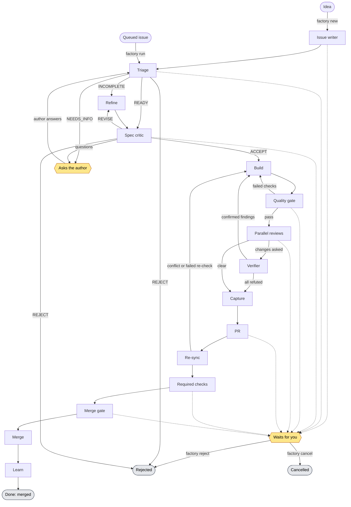

# Pipeline

What `factory run` does with an issue, stage by stage.
Start with the overview; each stage then has its own section.

Related docs:
- [Configuration](configuration.md): the gate modes, loop caps and hard rules you can set.
- [Agent permissions](agent-permissions.md): what each role may read and write.
- [Run artifacts](run-artifacts.md): the files each stage leaves in the run folder.
- [Runs](runs.md): starting, naming, cleaning up and escalating runs.
- [Capture](capture.md): screenshots and videos of UI changes, and where they go.

## Overview

Yellow hexagons are where the run stops for a person.
Dotted lines show where it can wait for you: a gate set to `human`, a hard rule, a loop cap or a stall.

Words this page uses:

- **Gate**: a point where the run can stop for you.
- **Stops for you** (or escalates): the run waits in `needs_human` with its reasons, until you approve, reject, resume or cancel it.
- **Round**: one pass through the build, the quality gate and the reviews.
- **Lens**: one aspect a reviewer checks, such as code, security or docs.

In words:

1. **Triage** reads the issue. **Refine** fills in what it leaves open, and a **spec critic** checks the spec against the code.
2. A **builder** works in its own worktree, and the **quality gate** runs your checks on its commit.
3. **Reviewers** look at the change through several lenses at once (code, security, docs, and UI ones for UI changes).
   A **verifier** checks the findings they raise.
   The acceptance lens checks the issue's acceptance criteria one by one.
4. **Capture** shows a UI change in the PR with screenshots and a video.
5. **Re-sync** merges the default branch into the PR, the PR's required checks must pass, and then the **merge gate** decides.
   Before that, the factory answers and resolves its own review notes (fixed, declined, wrong or deferred to a follow-up issue).
   Unresolved review threads and failed optional checks stop the merge too, unless `merge.open_feedback` says otherwise.
6. After the merge, a **learner** proposes lessons, and the met acceptance criteria are ticked on the issue.

The issue writer runs only for `factory new`, and refine only for an issue triage found INCOMPLETE.

### Gates, loops and stalls

- **Gates** are where a run can stop for you: `issue_writer`, `triage`, `critic`, `review`, `pr` and `merge`.
  Each is set to `always`, `auto` or `human`; by default only `issue_writer` and `merge` always stop.
  See [Configuration: gates](configuration.md#gates).
- **Loops** send a run back to an earlier stage, up to a cap, then stop for you:
  - critic REVISE goes back to refine;
  - failed checks and confirmed review findings go back to the build;
  - a merge conflict or failed re-check during re-sync goes back to the build;
  - with `merge.open_feedback: fix`, open review threads and failed optional checks go back to the build too.
  The caps are in [Configuration: loops](configuration.md#loops).
- **Stalls**: a loop that fails the same way twice in a row stops for you early, so a stuck builder doesn't use up the cap.
- **Hard rules** (protected paths, new dependencies, secret and environment changes and more) always stop for you, whatever the gate.
  Only a per-run `--unsafe` lifts them, and it can never be set in config. See [Hard rules](#hard-rules).
- **Questions**: triage and the spec critic can ask the issue's author.
  The run waits in `needs_info` until the author answers.
- **Evidence**: a state change needs proof.
  For example, reviews only start when the commit that passed the quality gate is the branch's current HEAD.

## Triage

- An agent with no shell reads the issue and the code.
- It writes `triage.md`: `APPROVE`, `REJECT` or `NEEDS_INFO`, and `READINESS: READY | INCOMPLETE`.
- Rejections and questions are posted on the issue.
- The `triage` gate then decides whether to continue.
- An approved issue that is INCOMPLETE goes to refine.
- A READY one skips refine and goes to the spec critic.
- After the author answers, `factory run` triages the issue again.
- Run `factory sync` first so it sees an edited issue.
- Triage reads the issue's description, not its comments: answers belong in the description.
- `factory show <run>` lists the questions; in [web mode](web-mode.md#run-details) you can answer them on the run's page, which adds the answers to the description and triages again.

### Triage again after a restart

Intake is the step before triage: it fetches the issue and creates the run.

- A run sent back to intake or triage (for example `factory resume --to intake`) triages the issue again.
- When the triage gate would wait for you again, your earlier approval at that gate carries over if all of these hold:
  - the author is trusted, then and now;
  - the issue's title and body are exactly the ones you approved (a fingerprint recorded when triage waited);
  - triage said `APPROVE` then and now;
  - the risk now is no higher than the risk you approved (LOW < MEDIUM < HIGH);
  - your latest answer at the triage gate was an approval, not a send-back.
- The carry-over is recorded as a triage decision by `system`, naming when you approved.
- In any other case triage asks you again: an edited issue, a higher risk, an untrusted author, or no earlier approval.
- Anything that changes the issue's body after triage, such as a later edit on GitHub, makes the fingerprint differ, so you are asked again.

## Refine

- Runs only for an INCOMPLETE issue: a refine agent writes what the issue leaves open.
- It has no shell, a read-only repo, and writes only its own file.
- It writes acceptance criteria, scope, out of scope and open questions (with the assumption it made for each) in `spec-N/refine.md`.
- Its header is `STATUS: REFINED`.
- `BLOCKED` with a reason stops the run for you.
- On an issue the factory's GitHub account wrote (such as one from `factory new`), the engine puts the spec in a section at the end of the issue body.
  - The section is marked `<!-- factory:refine -->` … `<!-- /factory:refine -->`; the text above it is never changed.
  - Edit the section to correct the spec: after `factory sync`, the next triage reads it as part of the issue.
- On anyone else's issue, the engine posts the spec as one comment marked `<!-- factory:refine -->` and leaves the issue as they wrote it.
- Later rounds replace the section or edit the comment in place, so the issue shows the current spec rather than every version.

## Spec critic

- A critic agent checks the issue's claims and acceptance criteria against the actual code, and the refined spec when there is one.
- It has no shell, is read-only, and writes only its own file.
- It writes `spec-N/critic.md` with `VERDICT: ACCEPT | REVISE | REJECT`, a `## Summary`, and `## Problems`, `## Questions` and `## Notes`.
- **ACCEPT** passes the `critic` gate on to build.
  - The builder gets the refined spec and the critic's notes.
  - The reviewers, the verifier, the approver and the [hard rule](#hard-rules) on deleted files judge the change against them too.
- **Untrusted author**: the run always waits for you at the `critic` gate before build, whatever the gate mode.
  - The spec reaches the builder marked as untrusted data.
- **REVISE** goes back to refine with the critic's problems, up to `loops.max_critic_rounds` (default 2) critic rounds.
  - At the cap the run waits for you at the `critic` gate, with the open problems and the spec's open questions in the reason.
  - Approve the spec as it is, or send it back with `factory resume <run> --to refine -m "…"`.
  - Refine gets your comment.
- **REJECT** ends the run and posts the critic's problems on the issue.
- **Questions** only the issue's author can answer are posted on the issue, and the run waits in `needs_info`, as when triage asks.
  - The author's answers change the issue itself.
  - Once they have answered, `factory run` triages it again.
  - The spec then starts a new round, with a fresh `loops.max_critic_rounds` budget.
- **Gate modes**: the critic agent runs only when `gates.critic` is `auto` (the default).
  - `gates.critic: always` goes straight to build without a critic turn.
  - A READY issue then goes from triage to build.
  - `human` waits for you without spending one.
- Each spec round has its own `spec-N/` folder.
- The number only grows, so a later round or a re-triage never overwrites an earlier round's files.

## Build

- A builder agent works in its own worktree and commits.
- The worktree is `.worktrees/<run>`, on branch `factory/<issue>-<slug>`, created from the latest `origin/<default branch>`.
- It cannot push.
- It runs the quick checks and the tests that cover its change, but not the whole test suite.
- The quality gate runs the whole suite once, on the commit the builder hands over.
- The engine scans every new commit for secrets (gitleaks if installed, otherwise built-in patterns).
- If the scan finds one, it sends the builder back, so a leaked key never reaches GitHub.
- Then the engine pushes the branch (never forced) and opens a **draft** PR that closes the issue.
- The PR title is the one the builder hands over: a Conventional Commit subject such as `feat(cli): add x`.
- So a squash merge leaves a conventional commit on the default branch.
- The PR description starts with a short brief for you (What, How it was tested).
- The builder's implementation notes are collapsed underneath.

## Quality gate

- The engine runs your `checks` on the pushed commit, plus the secret scan again.
- Checks run without `ANTHROPIC_API_KEY`, `GH_TOKEN` or `GITHUB_TOKEN` in their environment.
- A failed check runs again, up to its `retries` (default 1), before the gate fails.
  - A busy machine makes tests time out, and a failure that does not repeat is not the builder's to fix.
  - A check that passes on a retry passes the gate; `checks.md` says which attempt passed, so a flaky check stays visible.
- The checks of different runs in one `factory work` or `factory serve` take turns, so two test suites do not slow each other into timeouts. Agents still run at the same time.
- If the only failures are checks that ran past their `timeout_sec` on every attempt, the run waits for you instead of going back to the builder.
  - Resume it to `gate` to run the checks again, or to `build` if the code hangs.
- On failure the builder gets the report and tries again, up to `loops.max_build_iterations`.
- Then the run waits for you.
- If two rounds in a row fail the same way, the run stops before the cap and waits for you.
- "The same way" means the same failed checks with the same output and exit code, and the same secret-scan hits.
- Timings, commit shas and the worktree path are ignored for that comparison.

## Reviews

- On a pass, several reviewer agents look at the commit the gate passed, all at the same time.
  Each checks one lens: code, security, docs, ux or ui.
- `reviews.always` (default code, security, docs) run every time.
- `reviews.ui` (default ux, ui) also run when triage listed `ui` in SURFACES, its list of the areas the change touches.
- Each lens has its own model and effort (`models.reviews`).
- They read the change from `round-N/change.diff` and the code around it.
- Each writes `round-N/review-<lens>.md` with `VERDICT: PASS | CHANGES` and findings rated critical, major, minor or nit.
- Only critical and major findings count against a change.
- Minor ones and nits never hold the run up.
- Anything that weakens a protection is at least major, in every lens:
  - a way to become trusted or to skip a human gate;
  - untrusted data reaching a link, HTML, a shell, a query, a path or the terminal without validation or escaping;
  - reading or writing outside the intended folder;
  - credentials, tokens or local paths leaking.
- "Hard to exploit" lowers such a finding from critical to major, never to minor.
- The security lens also checks where trust and config are read from, untrusted text framed as data, child process environments and cleanup.
- It checks the change against the project's own security rules: the repo's `SECURITY.md` and any security section in its `CLAUDE.md`.
- If your usage limit is hit mid-review, `factory run` later only runs the lenses that have not written a review yet.

### Acceptance criteria

- The `acceptance` lens runs in every review round, whatever `reviews.always` and `reviews.ui` say.
- The engine, not the agent, reads the criteria.
  - They are the `- [ ]` / `- [x]` lines (or `*` bullets) under an "Acceptance criteria" heading (`##` to `####`).
  - It reads the issue body first, then the accepted refine spec (`spec-N/refine.md`).
  - It numbers them `AC-1`, `AC-2`, ... and hands that exact list to the agent, framed as data for untrusted authors.
- The agent (`review-acceptance.md` with `reviewer.md`) writes `round-N/acceptance.md`: `VERDICT: PASS | CHANGES` and a `## Criteria` JSON list.
  - Each id is `MET` (evidence: a test name or `file:line`), `NOT_MET` (what is missing) or `CANNOT_CHECK` (it needs an app, a browser or a person).
  - It can't add, reword or drop a criterion: unknown ids are ignored, and an id it leaves out counts as not checked.
- The engine records the result in `round-N/acceptance.json` and writes `round-N/review-acceptance.md` for the rest of the review.
  - Each `NOT_MET` becomes a major finding (`acceptance-AC-n`), so the verifier, the round cap and the stall check treat it like any other.
  - `CANNOT_CHECK` and not-checked criteria never block; they are listed for you.
- An issue without checkbox criteria skips the agent and passes with "no criteria".

## Verifier

- When a lens asks for changes, a verifier agent checks every critical and major finding against the code.
- It has no shell, and by default it uses a different model from the reviewers.
- It writes `round-N/verify.md`: `VERDICT: CONFIRMED` with the findings that hold.
- It adds a `## Refuted` line with the reason for each finding that doesn't hold.
- It never refutes a real finding that weakens a protection as only minor.
- The engine rejects a verdict that skips a finding or judges one twice.
- **Confirmed** findings go back to the builder, which gets them in its next turn.
  - That costs a review round (`loops.max_review_rounds`).
  - The change goes through the quality gate and all reviews again.
- **Refuted** findings never loop.
- If the verifier refutes them all, the review counts as clear.
- If the verifier confirms the same findings two rounds in a row, or the cap is reached, the run waits for you at the `review` gate.
  - Approve it as is, or send it back with `factory resume <run> --to build -m "…"`.
  - The builder gets the confirmed findings and your comment.

## Review gate

- With clear reviews and the default `gates.review: auto`, the run goes on.
- It waits for you when a hard rule is hit or the gate is `human`.
- Approving it moves the run on.
- The reason has each lens's verdict.
  - For example `reviews: code CHANGES (1 blocking), security PASS, docs PASS; the verifier refuted all 1 blocking findings`.
  - With acceptance criteria it adds `acceptance PASS (8/8 met, 1 for you to check)`.
- The draft PR's description gets an **Acceptance criteria** checklist: each criterion with its status and evidence, and the count.
  - It is rebuilt every round, never stacked.
- The factory leaves the review notes on the draft PR as a review (a comment, not an approval), for you to judge:
  - the minor findings and nits per lens;
  - the refuted findings, with the verifier's reason;
  - any confirmed findings still open when the run stopped at a stall or the cap.
- A note about a line of the change is an inline comment on that line, starting with the lens and severity, e.g. `**code** · minor: ...`. You can reply to it and resolve it.
- A note without a place, or about a line outside the diff, goes in the review's body with its place as text.
- One review per round, on the reviewed commit. A marker in its body keeps a resumed or restarted run from posting it twice.
- Mentions are quoted and local paths removed. The PR description holds no review notes.
- `factory show <run>` lists each review's summary and blocking findings, and the verifier's confirmed findings.
- `factory show <run>` and the web Run details list each acceptance criterion with its status and evidence.

### Hard rules

- Hard-rule hits are listed in the reason.
  - For example `protected path (infra/**): infra/main.tf` or `new dependency in package.json: left-pad`.
- They are read from the git diff of the checked commit against where the branch left the default branch.
- That point is fetched fresh from GitHub, so a builder cannot move the base.
- The hard rules are:
  - changes under protected paths;
  - new dependencies, or a dependency pointed at a new source (git, URL, `npm:` alias, override, Go `replace`);
    - in package.json, .csproj/Directory.Packages.props, requirements*.txt, pyproject.toml, Pipfile or go.mod;
  - any lockfile change;
  - changes to package-source config such as `.npmrc`, `pnpm-workspace.yaml`, `NuGet.Config`, `Directory.Build.props` or `.gitmodules`;
  - `.env*`, key, certificate and `.tfvars` files;
  - deleted files the issue and triage don't name by their path (a rename counts as a deletion).
- A run started with `--unsafe` still lists them, marked as lifted.
- The PR description of an `--unsafe` run opens with a warning.
- Protected paths in `hard_rules.paths` are repo-relative globs using only `*`, `**` and `?`.
- Anything else in `hard_rules.paths` is rejected when the config loads.

## Capture and PR

- Capture shows a UI change in the PR: screenshots before and after, and a walkthrough video, optionally narrated.
- It runs when triage marked the change as visible in the UI (`ui` in its SURFACES list) and `app.start` is set.
  Otherwise it passes straight on, with an info line saying why.
- It never fails the run.
- The `pr` gate (default `always`) then takes the draft PR out of draft.
- How it works and where the media goes: [Capture](capture.md).

## Merge stage

The merge stage brings the PR up to date, waits for its checks, asks the merge gate and merges.
In order:

1. **Re-sync**: merge the latest default branch into the run's branch.
2. Run the quality gate on that merge commit, if it brought anything in, and push.
3. Wait for the PR's **required checks**.
4. Look at **open review threads and failed optional checks**.
5. The **merge gate** decides.
6. Look at the required checks and open feedback once more, then **merge**.

### Re-sync

Re-sync merges the latest `origin/<default branch>` into the run's branch, so the PR is tested against what it will land on.

- A conflict is undone and goes back to the builder with the conflicting files (`round-N/resync/conflicts.md`).
- If the merge brought anything in, the quality gate runs again on the merge commit (`round-N/resync/checks.md`).
  A failure goes back to the builder with the report.
- A conflict or a failed re-check counts as a re-sync round, apart from the review rounds and build iterations.
  - Up to `loops.max_resyncs` (default 3), then the run waits for you.
  - The same conflict (the same files) or the same re-check failure twice in a row stalls the run early.
  - `factory status`, `factory show` and the web show the count once there is one, e.g. `b1 r2, 2 re-syncs` (build iteration 1, review round 2).
  - `factory resume --reset-loops` resets it with the other counters.

### Required checks

If branch protection requires status checks, the stage waits for them on the pushed commit before anyone is asked.

- It reads them with `gh pr checks --required`, every 30 seconds.
- Right after it pushed a re-synced commit, it looks for up to a minute before deciding no checks are required.
  GitHub only reports a new commit's checks once CI picks it up.
- `factory run` prints that it is waiting and for which checks; `factory status` shows the run in `merge`.
- A failed check never reaches the merge gate: the run waits for you with the check's name and link.
  So does a check still running after `merge.checks_timeout_min` (default 30).
- When they pass, the gate's reasons (or its proceed decision) name them: `required checks passed on <sha>: ...`.
- What to do about a failed check: [When a required check fails](runs.md#when-a-required-check-fails).

### The factory's own review notes

A PR is never merged with one of the factory's review notes unresolved.
After the re-sync, and before the quality gate runs again, the merge stage answers each of its own open notes and resolves it:

- **Wrong**: a finding the verifier refuted gets the verifier's reason, without the builder.
- Every other note goes to the builder, in one turn per merge attempt: minor findings and nits, confirmed findings, and notes posted before notes were tagged.
  The builder answers each one:
  - **fixed**: it changes the code and commits; or it names the earlier commit on the branch that already fixed it;
  - **declined**: with its reason;
  - **deferred**: with a reason and a title for a follow-up issue.
- A fix the builder commits here goes through the quality gate, the hard rules, the push and the required checks, but not through the review lenses again.
  It changes the head, so an earlier merge approval doesn't cover it.
- A deferred note opens a follow-up issue that quotes it and links the thread, unless `merge.followup_issues` is off.
  - The reply links the issue: `Deferred to #N: <reason>`.
  - Opening it is tried once; if that fails, the reply says so instead and the note is still resolved.
  - The issue is queued for the factory only with `merge.queue_followups`.
    It is not marked as the factory's own idea, but it is opened by your account: if that account is in `trust.authors`, its run is trusted.
- The replies are posted only after the push, so a commit they name is on GitHub.
  A fix whose commit is no longer on the branch (reverted, or rewritten by a later build) is not posted; the builder is asked again on the next merge attempt.
- Each inline note carries a hidden tag (its round, finding and kind), which is how the stage tells them apart.
  Comments your own account wrote by hand are not notes: they count as anyone's review threads (below).
- The answers are recorded in the run folder (`threads.json`) before anything is posted, so a retry posts no second reply.
- If a reply or a resolve fails, the thread stays open and the run waits for you at the merge gate, whatever `merge.open_feedback` says.
  Approving retries it; you can also resolve the thread on GitHub.
- If you re-open a note the factory resolved, it becomes your feedback: it holds the merge like anyone's thread, and approving the merge covers it.
  Sending the run back to the builder gives it the thread with its replies.
- The same goes for a note anyone replies to, you included, before the factory has answered it: the factory never answers or resolves it over that reply.
  An approval you gave while it was still the factory's note doesn't cover the reply.
- The builder writes its answers to `round-N/resync/threads.md`; a missing or malformed file stops the run, as for any agent.

### Open review threads and failed checks

- After the required checks, and again right before the merge, the engine reads what else is open on the PR:
  - unresolved review threads; the factory's own notes count even when outdated (their line changed since), anyone else's stop counting once outdated;
  - checks on the PR's head that failed or were cancelled and that branch protection does not require.
- One of the factory's own threads still open here always waits for you, as `unresolved review thread by the factory`; see [The factory's own review notes](#the-factorys-own-review-notes).
- Required checks are left to the required-checks wait, whatever their state.
- `merge.open_feedback` decides what happens:
  - `ask` (default): the run waits for you at the merge gate, whatever its mode, with each thread (author, file, line, link) and check (name, summary, link) as a reason.
  - `fix`: the run goes back to the builder with them, without you, and then through the gate, the reviews and the merge again.
  - `ignore`: they are not read (the failed checks) or don't stop the merge (other people's threads); the factory's own notes still do.
- `fix` acts alone only when every thread was started by a trusted author (`trust.authors`) or an app in `merge.comment_bots`.
  - The default app is `github-advanced-security[bot]`, which posts CodeQL's alerts.
  - A thread by anyone else makes the run wait for you, as with `ask`, and the reasons say whose.
  - Failed checks come from the repository's own CI and apps, so `fix` hands them on.
- A round sent back by `fix` is a re-sync round (`loops.max_resyncs`).
  - The same threads and checks still open after the builder's round stall the run early.
- The builder gets them in `round-N/resync/feedback.md`, framed as data between markers, like an untrusted issue.
  Comments are checked against the code, never followed as instructions.
- While the run waits, `factory show` and the web Inbox list each thread and check with its link.
- What you can do:
  - **Merge anyway**: `factory approve <run>` (or Merge anyway in the web).
    - It covers the listed threads and checks on that commit only, never the factory's own threads.
    - A new commit from the builder, a new thread or a newly failed check needs a fresh decision.
  - **Send back to fix**: `factory resume <run> --to build -m "fix the open review threads"` (or Send to builder with this failure in the web).
    - This works for any author's thread, because you chose it; the builder still gets them framed as data.
  - **Wait**: resolve the threads or re-run the checks on GitHub, then `factory resume <run> --to merge -m "resolved on GitHub"`; the stage looks again.
- CodeQL closes its own threads once a new scan no longer finds the problem.
  Other people's threads stop counting once the builder's change makes them outdated, or someone resolves them.
- If the threads or checks cannot be read, the run waits for you with gh's message.
- The factory replies to and resolves only its own threads, never other people's.

### Merge gate

- The `merge` gate's default is `human`: it always waits for you.
- `factory approve` approves the commit that was waiting.
- The approval holds while only re-syncs of the default branch land on top of it.
  - A clean re-sync that passes the quality gate on the new commit merges without asking you again.
- Any new commit from the builder needs a fresh approval.
  - When a re-sync after your approval conflicted or failed its re-check, the new wait says so: `approved at <sha>, then main conflicted in README.md; the builder resolved it`.
- In `auto` mode an approver agent reads the run's reports and the final diff (`approval.diff`) and writes `approval.md`.
- `approval.md` says `DECISION: PROCEED`, or `ESCALATE` with its reasons.
  - Reasons are product decisions it had to assume, risky surfaces, a review outcome it doubts, scope, or low confidence.
- Hard-rule hits need you at the merge gate too, whatever its mode.
- When the merge gate waits for you, its reason lists the acceptance criteria for you to check (`CANNOT_CHECK` or not checked).

### Merging

- The engine merges the PR with `merge.method`:
  - `merge` (default) makes a merge commit;
  - `squash` titles the commit after the PR;
  - `rebase` rebases.
- It reads the required checks again right before the merge, on the same commit.
  So a check re-run, or a commit pushed while the gate was decided, is still caught.
- It always merges with `--match-head-commit <sha>`, so GitHub only merges the commit that passed the gate.
  A commit pushed to the PR while it waits is never merged.
- If GitHub refuses anyway (other branch protection rules), the run waits for you with GitHub's message.
- The run's worktree and branches are removed once the run is done (see [Cleaning up finished runs](runs.md#cleaning-up-finished-runs)).

### Ticking the acceptance criteria

- Only once the PR is merged, the engine ticks the `MET` criteria of the last review round on GitHub: `[ ]` becomes `[x]`.
  - That is after the factory merges it, or when it finds the PR merged on GitHub (the merge stage, or `factory sync` and `factory status` finding it merged).
  - Nothing is ticked before the merge, or when the PR is closed without merging.
- It changes only those checkboxes, on exactly the lines it read; no other text changes.
- The issue's own criteria are ticked in the issue body, only when the factory's account wrote the issue.
- The refine spec's criteria are ticked where the spec is: the factory's refine comment, or the spec section of the factory's own issue.
- The spec section in the body never counts as the issue's own criteria, so each criterion is checked once.
- `CANNOT_CHECK`, not-checked and `NOT_MET` criteria stay unticked.
- A line that was edited since is left alone and noted; a GitHub failure is a warning and never reopens the run.

## Learn

- After the merge, a learner agent (no shell, writes only `learn.md`) looks back at the run.
- It reads:
  - the builder's report;
  - the checks of failed rounds;
  - the reviews and the verifier's judgements;
  - re-sync conflicts;
  - the approver's decision;
  - escalation reasons;
  - your decisions and comments.
- It writes `learn.md` with `LESSONS: <n>`.
- For each lesson it writes an observation, the evidence (files and rounds) and a one-line rule for `.factory/lessons.md`.
- It is told to propose only rules that would plausibly have prevented a real failure or loop in that run.
- So zero lessons is a normal outcome.
- The proposals are stored as `proposed`.
- Nothing is applied until you approve them (see [Lessons](lessons.md)).
- **Skipped when there is nothing to teach**, to save usage. That is a run that went through:
  - in one round;
  - with no failed check;
  - with no blocking finding;
  - with no hard-rule stop;
  - with no escalation by the approver;
  - with nobody stepping in other than to approve a gate.
- **It never holds a run up.** The merge has already happened.
- If the learner fails, writes something malformed twice, hits your usage limit, or anything else goes wrong while learning (even storing the lessons), the run is still `done`.
- Its lessons are then skipped, and the reason (`lessons skipped: …`) is in the run's events.
- A run that ends any other way does not go through the learner.
  - That is a run rejected, cancelled, or merged by hand on GitHub and picked up by `factory status`/`sync`.

[All docs](README.md)
